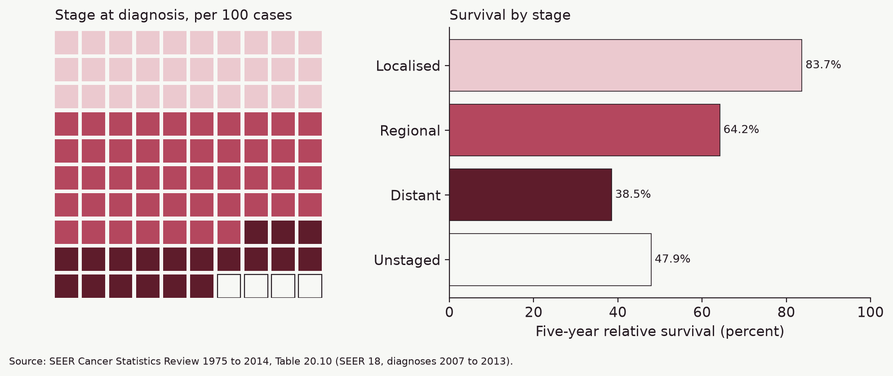

# Oral cancer figures: data and notebooks

Pushti Shah, BDS, MSc

This repository holds the data and code behind the charts in the oral cancer articles on [shah-pushti.github.io](https://shah-pushti.github.io). Each value was transcribed from the published source named next to it. Each notebook reads the data, checks it for internal consistency where the source allows, and redraws the chart.

| Notebook | Article | Source | Open |
|---|---|---|---|
| [Estimated new cases by country, 2022](notebooks/cases-by-country.ipynb) | [Oral cancer: estimated new cases by country and five-year survival by stage](https://shah-pushti.github.io/oral-cancer-in-numbers.html) | GLOBOCAN 2022 (World Cancer Research Fund) | [](https://colab.research.google.com/github/shah-pushti/oral-cancer-figures/blob/main/notebooks/cases-by-country.ipynb) |
| [Stage at diagnosis and five-year relative survival](notebooks/stage-and-survival.ipynb) | same article | SEER Cancer Statistics Review 1975 to 2014, Table 20.10 | [](https://colab.research.google.com/github/shah-pushti/oral-cancer-figures/blob/main/notebooks/stage-and-survival.ipynb) |
| [Kerala screening trial: participant flow and mortality rate ratios](notebooks/kerala-trial.ipynb) | [Oral visual screening and deaths from oral cancer: the Kerala trial](https://shah-pushti.github.io/oral-cancer-screening-kerala-trial.html) | Sankaranarayanan et al., The Lancet 2005 | [](https://colab.research.google.com/github/shah-pushti/oral-cancer-figures/blob/main/notebooks/kerala-trial.ipynb) |



## Checks in the notebooks

- Kerala trial: people who attended referral equal the sum of the three diagnostic outcomes (2,252 + 131 + 835 = 3,218), and screen-positive people equal those who attended plus those who did not (3,218 + 1,927 = 5,145).
- SEER: the share-weighted average of the stage-specific survival figures is compared with the all-stages figure (64.5 percent).

## Repository layout

```
data/        CSV files, one per source table (data dictionary in data/README.md)
notebooks/   Jupyter notebooks; each runs on its own in Colab or locally
figures/     PNG and SVG output of the notebooks
```

## Run locally

```
pip install -r requirements.txt
jupyter notebook notebooks/
```

## Licence

Code: MIT (see LICENSE). Data files: the values are facts reported in the cited publications; the CSV files are shared under CC BY 4.0, and the rights in the original publications remain with their publishers.

## Sources

- World Cancer Research Fund. Mouth and oral cancer statistics (GLOBOCAN 2022). https://www.wcrf.org/preventing-cancer/cancer-statistics/mouth-and-oral-cancer-statistics/
- Surveillance, Epidemiology, and End Results Program. SEER Cancer Statistics Review 1975 to 2014, Table 20.10. https://seer.cancer.gov/archive/csr/1975_2014/results_single/sect_20_table.10.pdf
- Sankaranarayanan R, Ramadas K, Thomas G, et al. Effect of screening on oral cancer mortality in Kerala, India: a cluster-randomised controlled trial. The Lancet 2005;365:1927-33. https://doi.org/10.1016/S0140-6736(05)66658-5
